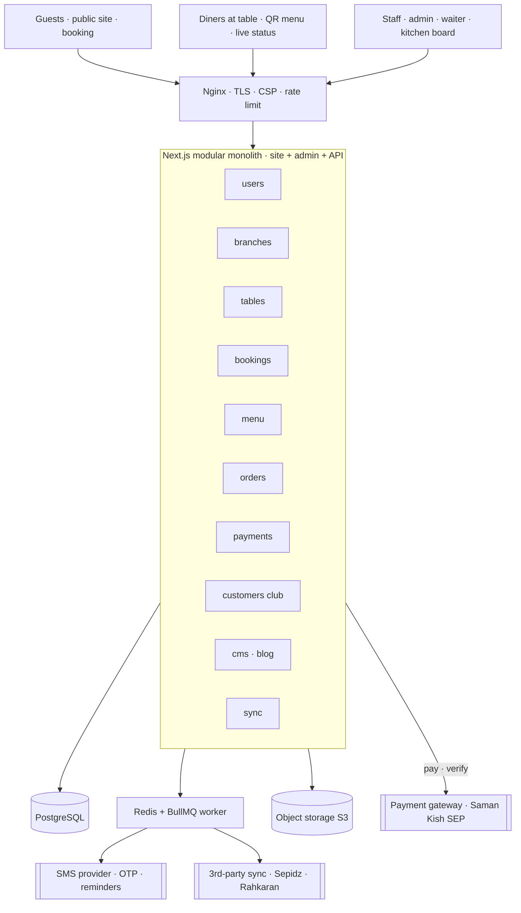

# Nakaya Restaurant Platform — سند جامع پروژه

Oct 26, 2026 · @Ayhan

## ۱. خلاصه اجرایی

پلتفرم ناکایا (رستوران آسیایی لوکس، الهیه، میدان آقابزرگی، هم‌مجموعه با ام کافه؛ شعبه دوم: Izakaya در میکا مال کیش) شامل سایت عمومی دوزبانه، سفارش با QR روی میز، رزرو آنلاین، باشگاه مشتریان و پنل ادمین است. برآورد اجرا با Claude Code حدود **۱۶ هفته در ۱۰ فاز** است و هر فاز با گیت کیفیت قابل اندازه‌گیری بسته می‌شود.

### ارزیابی صادقانه نیازمندی‌ها

فهرست اولیه خوب است، اما چند نقص ساختاری دارد که اگر الان اصلاح نشود، در فاز سفارش و گزارش‌گیری هزینه بازنویسی دارد:

| مورد در نیازمندی | مشکل | اصلاح پیشنهادی |
| --- | --- | --- |
| Users + Customers club | کارکنان و مشتریان در یک جدول، با مدل احراز هویت متفاوت | دو موجودیت جدا: `staff_users` (رمز + نقش) و `customers` (ورود با OTP پیامکی) |
| Delete user / item / branch | حذف فیزیکی، سفارش‌ها و گزارش‌های قدیمی را می‌شکند | Soft delete (`deleted_at`) + Audit log برای همه عملیات |
| `work_hours` | یک فیلد متنی برای ساعت کاری قابل محاسبه نیست | جدول `branch_hours` با روز هفته، شیفت‌های چندگانه و تعطیلات خاص |
| `uuid[QR-code]` | اگر QR لو برود، قابل ابطال نیست | `qr_token` جدا از کلید اصلی، قابل چرخش (rotate) |
| Booking | بدون مشتری، تعداد نفرات، وضعیت و جلوگیری از تداخل | `party_size`، `status`، `customer_id` + قید Exclusion در PostgreSQL روی بازه زمانی |
| Menu item با `branch_id` | تکرار هر آیتم برای هر شعبه؛ دسته‌بندی، توضیح، آلرژن و نام انگلیسی وجود ندارد | `menu_items` سراسری + `branch_menu_items` برای قیمت و موجودی هر شعبه + `categories` و `modifiers` |
| `items`, `total_price` در Order | قیمت لحظه سفارش ذخیره نمی‌شود؛ تغییر منو گزارش‌ها را عوض می‌کند | `order_items` با snapshot نام و قیمت واحد |
| `payed_price`, `payed_price_unit` | غلط املایی (paid) و ابهام ریال/تومان | جدول `payments` جدا (چند پرداخت برای یک سفارش)؛ مبالغ فقط `BIGINT` به ریال، نمایش به تومان |
| `is_accepted` | یک Boolean چرخه سفارش را مدل نمی‌کند | State machine وضعیت سفارش (بخش ۶) |
| Career positions | فقط آگهی؛ دریافت رزومه نیست | `job_applications` با آپلود امن فایل |

### درباره الزام «همه چیز ≥ ۹۸ از ۱۰۰»

نمره‌ای که هوش مصنوعی به کار خودش می‌دهد تقریباً همیشه بالا است و ارزش اثباتی ندارد. به همین دلیل در این سند **نمره ۹۸ به معیارهای قابل اندازه‌گیری تبدیل شده** (بخش ۳): ابزارهای خودکار، یک Reviewer مستقل که کار را ننوشته، و تأیید نهایی شما. هر جا تصمیمی امروز به ۹۸ نمی‌رسد، با دلیل و شرط رسیدن به ۹۸ ثبت شده است.

## ۲. تیم پروژه و نقش‌ها

تیم ۱۳ نقش دارد: ۳ نقش انسانی که قابل حذف نیستند و ۱۰ نقش که در Claude Code به‌صورت Subagent در `.claude/agents/` تعریف می‌شوند. هر Subagent فقط ابزارها و پوشه‌های حوزه خودش را دارد.

| نقش | مجری | مسئولیت اصلی | خروجی کلیدی |
| --- | --- | --- | --- |
| Product Owner / مدیر پروژه | انسان (شما) | اولویت‌بندی، تأیید گیت هر فاز، ارتباط با مالک رستوران | Backlog، تأیید Release |
| نماینده رستوران | انسان (مدیر ناکایا) | تأیید منو، قیمت‌ها، سیاست رزرو، لحن برند | Sign-off محتوا |
| عکاس غذا و فضا | انسان (حرفه‌ای) | عکاسی انجام شده؛ تحویل فایل‌های اصلی و Retouch نهایی | ۶۰+ عکس RAW با مجوز استفاده |
| `pm-analyst` | Subagent | تبدیل نیازمندی به User Story با Acceptance Criteria | `docs/stories/*.md` |
| `brand-designer` | Subagent + Design artifacts | هویت بصری، پالت، تایپوگرافی، گرید | Brand book، Design tokens |
| `ux-designer` | Subagent + Design artifacts | جریان کاربر، وایرفریم، صفحات Hi-fi سایت و ادمین | Flow‌ها و Mockup‌ها |
| `architect` | Subagent (Plan) | معماری، مدل داده، ADR | `docs/adr/*.md`، ERD |
| `backend-engineer` | Subagent | دیتابیس، سرویس‌ها، API، صف‌ها | کد `src/modules/*/{domain,server}` + تست |
| `frontend-engineer` | Subagent | UI سایت و ادمین، RTL، انیمیشن | کد `src/app/**`، `src/modules/*/ui، src/shared/ui` |
| `qa-engineer` | Subagent | تست واحد، یکپارچه، E2E، دسترس‌پذیری | گزارش تست و پوشش |
| `security-reviewer` | Subagent (فقط خواندنی) | بررسی OWASP ASVS، وابستگی‌ها، RBAC | گزارش امنیتی هر فاز |
| `code-reviewer` | Subagent (فقط خواندنی، مستقل) | امتیازدهی کد و طراحی با روبریک بخش ۳ | Scorecard هر PR |
| `devops` | Subagent + شما | Docker، CI/CD، بکاپ، مانیتورینگ | Pipeline و Runbook |

### ماتریس RACI

R = انجام‌دهنده، A = پاسخ‌گو، C = مشورت، I = مطلع

| خروجی | PO | رستوران | Brand/UX | Architect | Backend | Frontend | QA | Security | Reviewer |
| --- | --- | --- | --- | --- | --- | --- | --- | --- | --- |
| نیازمندی و Story | A | C | C | C | I | I | C | I | I |
| هویت بصری | A | C | R | I | I | C | I | I | C |
| معماری و ADR | A | I | I | R | C | C | C | C | C |
| پیاده‌سازی Backend | I | I | I | C | R | I | C | C | A |
| پیاده‌سازی Frontend | I | I | C | I | C | R | C | I | A |
| تست و گیت کیفیت | A | I | I | I | C | C | R | C | C |
| امنیت | A | I | I | C | C | C | C | R | C |
| Release | A | C | I | C | C | C | R | C | C |

قاعده کلیدی: **Reviewer هیچ‌وقت کدی را که خودش نوشته امتیاز نمی‌دهد** و در یک Session تازه اجرا می‌شود تا سوگیری نداشته باشد.

## ۳. سیستم امتیازدهی (حداقل ۹۸ از ۱۰۰)

هر خروجی فقط وقتی پذیرفته می‌شود که **همه گیت‌های اجباری سبز** باشند و نمره روبریک حداقل ۹۸ شود. گیت اجباری قرمز یعنی نمره صفر، هر چقدر بقیه موارد خوب باشد.

### کد (هر PR)

| معیار | وزن | روش اندازه‌گیری | شرط نمره کامل |
| --- | --- | --- | --- |
| Type safety | ۱۰ | `tsc --noEmit` با `strict` و `noUncheckedIndexedAccess` | صفر خطا، صفر `any` و `@ts-ignore` |
| Lint و فرمت | ۱۰ | ESLint + Prettier در CI | صفر خطا و صفر هشدار |
| تست | ۲۰ | Vitest + Playwright | پوشش ≥ ۹۰٪ در `server/domain`، همه سناریوهای Acceptance سبز |
| امنیت | ۲۰ | `pnpm audit`، Semgrep، چک‌لیست ASVS L2 | صفر آسیب‌پذیری High/Critical |
| معماری و خوانایی | ۲۰ | Reviewer مستقل | تابع ≤ ۴۰ خط، بدون تکرار، مرز لایه‌ها رعایت شده |
| کارایی | ۱۰ | Lighthouse CI، `EXPLAIN` کوئری‌ها | صفحات عمومی Performance ≥ ۹۵ موبایل؛ بدون N+1 |
| مستندسازی | ۱۰ | Reviewer | ADR برای تصمیم جدید، JSDoc برای API عمومی، CHANGELOG |

### طراحی (هر صفحه)

| معیار | وزن | شرط نمره کامل |
| --- | --- | --- |
| وفاداری به Design tokens | ۱۵ | هیچ رنگ، فاصله یا فونت خارج از توکن‌ها |
| سلسله‌مراتب بصری | ۱۵ | یک CTA اصلی در هر صفحه؛ تست ۵ ثانیه‌ای موفق |
| RTL و تایپوگرافی فارسی | ۱۵ | اعداد فارسی، نیم‌فاصله درست، آیکون‌های جهت‌دار قرینه |
| دسترس‌پذیری | ۲۰ | WCAG 2.2 AA؛ axe صفر خطا؛ کنتراست متن ≥ ۴.۵:۱ |
| واکنش‌گرایی | ۱۵ | بی‌نقص در ۳۶۰، ۷۶۸، ۱۲۸۰ و ۱۹۲۰ پیکسل |
| حس لوکس و برند | ۲۰ | تأیید نماینده رستوران + Reviewer روی چک‌لیست بخش ۴ |

### تصمیم‌ها (هر ADR)

| معیار | وزن |
| --- | --- |
| تعریف دقیق مسئله و محدودیت‌ها | ۲۰ |
| حداقل دو گزینه جایگزین واقعی | ۲۰ |
| Trade-off صریح (هزینه، ریسک، برگشت‌پذیری) | ۲۵ |
| تطابق با شرایط ایران (تحریم، میزبانی، درگاه) | ۲۰ |
| معیار بازبینی (چه زمانی تصمیم را عوض کنیم) | ۱۵ |

روش اجرا: بعد از هر کار، Subagent `code-reviewer` در Session جدید Scorecard را در `docs/scorecards/<phase>/<pr>.md` می‌نویسد. نمره زیر ۹۸ یعنی بازگشت کار با فهرست موارد کسرشده، نه بحث درباره نمره.

## ۴. هویت بصری و طراحی UI/UX

جهت طراحی پیشنهادی **«Sumi & Washi»** است: لوکس آرام ژاپنی، با فضای خالی زیاد (مفهوم Ma)، جوهر تیره، کاغذ واشی و فقط یک رنگ تأکیدی. لوکس در الهیه یعنی سکوت و دقت، نه طلای پرزرق و برق.

### آنچه ممنوع است

- کلیشه‌های «رستوران آسیایی»: اژدها، فانوس قرمز، بامبو، فونت‌های شبه‌چینی
- Gradient، سایه سنگین، Glassmorphism و انیمیشن‌های شلوغ
- عکس Stock یا تصویر ساخته‌شده با AI برای غذاهای منو؛ مشتری غذای واقعی را سفارش می‌دهد
- بیش از یک CTA اصلی در هر صفحه

### پالت (کنتراست‌ها محاسبه شده)

| توکن | رنگ | کاربرد | کنتراست |
| --- | --- | --- | --- |
| `ink` | `#121212` | پس‌زمینه تم تیره، متن اصلی تم روشن | ۱۶.۴:۱ روی washi |
| `washi` | `#F4EFE6` | پس‌زمینه تم روشن، متن تم تیره | ۱۶.۴:۱ روی ink |
| `stone` | `#5E5850` | متن ثانویه روی washi | ۶.۱:۱ |
| `ash` | `#9A938A` | متن ثانویه روی ink | ۶.۲:۱ |
| `kin` (طلایی مات) | `#B8A07A` | خطوط ظریف، آیکون، عنوان روی ink | ۷.۵:۱ |
| `shu` (قرمز مهر هانکو) | `#A8322A` | تنها رنگ تأکیدی: CTA و مهر لوگو | ۵.۸:۱ روی washi |

نکته صادقانه: قرمز روشن‌تر `#D9473B` روی ink فقط ۴.۴:۱ است و برای متن معمولی **رد می‌شود**؛ فقط برای آیکون یا متن بزرگ مجاز است.

### تایپوگرافی

| نقش | فونت پیشنهادی | مجوز |
| --- | --- | --- |
| تیتر فارسی | Peyda | تجاری؛ خرید مجوز Web تأیید شده |
| متن فارسی | Vazirmatn | OFL |
| تیتر لاتین و ژاپنی | Shippori Mincho | OFL |
| اعداد قیمت | ارقام فارسی با `tabular-nums` | — |

همه فونت‌ها Self-host می‌شوند (WOFF2 + subset)؛ Google Fonts از ایران پایدار نیست. مجوز هر فونت قبل از فاز ۱ باید دوباره بررسی شود.

### زبان طراحی

- گرید ۱۲ ستونه، حاشیه دسکتاپ ۹۶px، فاصله‌ها مضرب ۸
- عکس‌ها تمام‌عرض با نسبت ثابت؛ غذا روی زمینه تیره با نور جهت‌دار
- خط‌های ۰.۵px طلایی به‌جای کارت و سایه
- حرکت: فقط Fade و Reveal آرام (۴۰۰ تا ۶۰۰ میلی‌ثانیه، easing نرم)؛ احترام کامل به `prefers-reduced-motion`
- لوگو و هویت فعلی هر برند بدون تغییر حفظ می‌شود؛ پالت و تایپوگرافی بالا فقط در هماهنگی با رنگ‌های لوگوی فعلی نهایی می‌شوند و مهر هانکو صرفاً یک عنصر تزئینی اختیاری است

### صفحات سایت عمومی

1. خانه: Hero تمام‌صفحه با ویدیو یا عکس کوتاه سالن، یک CTA «رزرو میز»
2. منو: دو منوی جدا ناکایا و ام کافه با سوییچ برند، دسته‌بندی چسبان، فیلتر (تند، گیاهی، آلرژن)، عکس هر غذا
3. رزرو: تاریخ شمسی ← ساعت ← تعداد نفرات ← ورود یا ثبت‌نام با OTP و تکمیل اطلاعات فردی (نام، نام خانوادگی، موبایل) ← پرداخت بیعانه در صورت فعال بودن ← پیامک تأیید
4. شعبه و تماس: نقشه نشان (Neshan)، ساعت کاری زنده «الان باز است»
5. باشگاه مشتریان: امتیاز، سطح، سابقه بازدید
6. بلاگ و فرصت‌های شغلی

### جریان سفارش با QR

اسکن QR ← `/t/{qrToken}` ← منوی همان شعبه با شناسه میز ← سبد ← ثبت ← صفحه وضعیت زنده (پذیرفته، در حال آماده‌سازی، سرو شد). بدون نیاز به ثبت‌نام؛ ورود به باشگاه اختیاری است.

مسیر اصلی ثبت سفارش **گارسون سر میز** است (صفحه موبایل‌محور Waiter در ادمین). حالت QR برای هر شعبه، و در صورت نیاز هر میز، قابل تنظیم است:

| حالت QR | مشتری چه می‌بیند | کاربرد |
| --- | --- | --- |
| `menu_only` | فقط منو + دکمه «احضار گارسون» | پیش‌فرض؛ سفارش با گارسون |
| `order` | منو، سبد، ثبت سفارش + «احضار گارسون» | سالن شلوغ یا میزهای خاص |

سفارش مشتری از QR در وضعیت `pending` می‌ماند تا گارسون یا صندوق تأیید کند. احضار گارسون (دلیل: سفارش، صورتحساب، کمک) به‌صورت زنده با صدا روی صفحه گارسون‌های همان منطقه سالن اعلام می‌شود و در جدول `waiter_calls` با زمان پاسخ ثبت می‌شود.

### پنل ادمین

همان برند، اما تراکم بالاتر و کاربردی: داشبورد امروز (رزروها، سفارش‌های باز، میزهای اشغال)، Kanban زنده سفارش برای آشپزخانه، نقشه میزهای سالن، و جدول‌های قابل فیلتر. تم تیره پیش‌فرض برای محیط کم‌نور سالن.

خروجی فاز ۱ در Claude به‌صورت **Design System artifact** (توکن‌ها و کامپوننت‌ها) و **Design artifact** (صفحات Hi-fi) ساخته می‌شود تا قبل از کدنویسی قابل نقد و تأیید باشد.

## ۵. معماری فنی و Stack

معماری یک **Modular Monolith** روی Next.js است که روی سرور ایرانی با Docker اجرا می‌شود. برای یک رستوران با چند شعبه، Microservice فقط هزینه نگهداری اضافه می‌کند؛ ماژول‌ها طوری جدا می‌شوند که در صورت نیاز قابل استخراج باشند.



همه درخواست‌ها از Nginx به یک اپلیکیشن Next.js می‌رسند؛ کارهای کند مثل پیامک و Sync در Worker صف اجرا می‌شوند تا سفارش و رزرو منتظر سرویس خارجی نمانند.

| لایه | انتخاب | دلیل |
| --- | --- | --- |
| Framework | Next.js (App Router) + React + TypeScript strict | SSR/ISR برای SEO سایت، یک کدبیس برای سایت و ادمین، تجربه قبلی تیم |
| UI | Tailwind CSS + کامپوننت‌های Radix/shadcn بازنویسی‌شده با توکن‌های برند | دسترس‌پذیری Radix؛ ظاهر کاملاً اختصاصی، نه قالب پیش‌فرض |
| i18n و RTL | next-intl؛ فارسی پیش‌فرض، انگلیسی دوم | Routing بر اساس locale، پیام‌های type-safe |
| تاریخ | ذخیره `timestamptz` به UTC؛ نمایش شمسی با `Intl` (calendar=persian) و منطقه Asia/Tehran | بدون باگ ساعت تابستانی و تبدیل دستی |
| Database | PostgreSQL | قید Exclusion برای رزرو، JSONB برای محتوای CMS، تراکنش قوی |
| ORM | Drizzle ORM + Migration‌های SQL نسخه‌دار | نزدیک به SQL، type-safe، پشتیبانی از قیدهای خاص Postgres |
| Validation | Zod در همه مرزها (فرم، Server Action، API، env) | یک Schema برای کلاینت و سرور |
| Auth | Better Auth: ورود کارکنان با موبایل + رمز، مشتری با OTP | Session سمت سرور، Rate limit، بدون وابستگی خارجی |
| Realtime | Server-Sent Events + Postgres LISTEN/NOTIFY | کافی برای Kanban سفارش؛ ساده‌تر از WebSocket |
| صف و Cache | Redis + BullMQ | ارسال پیامک، Sync با سیستم‌های ثالث، پردازش تصویر |
| فایل‌ها | Object storage سازگار با S3 (MinIO یا سرویس ابری ایرانی) + `sharp` برای AVIF/WebP | تصاویر سبک و چندسایزه |
| پیامک | Adapter با پیاده‌سازی Kavenegar یا SMS.ir | تعویض سرویس بدون تغییر کد |
| پرداخت | Adapter درگاه سامان کیش (SEP) | تأیید نهایی در سؤالات باز |
| نقشه | Neshan Maps | Google Maps در ایران قابل اتکا نیست |
| ویرایشگر بلاگ | Tiptap با خروجی JSON و رندر sanitize‌شده | بدون HTML خام و XSS |
| تست | Vitest، Testing Library، Playwright، axe-core | واحد، کامپوننت، E2E، دسترس‌پذیری |
| مشاهده‌پذیری | pino (لاگ ساختاریافته)، GlitchTip (خطا)، Uptime Kuma | همه Self-host |
| زیرساخت | Docker Compose، Nginx، GitHub Actions یا Gitea Actions | استقرار با یک دستور، Rollback سریع |

### ساختار پوشه‌ها

```
src/
  app/
    [locale]/(site)/        صفحات عمومی
    [locale]/(admin)/admin/ پنل ادمین
    t/[qrToken]/            سفارش روی میز
    api/                    Webhook و SSE
  modules/
    users/ branches/ tables/ bookings/ menu/ orders/ payments/ customers/ cms/ sync/
      domain/      منطق خالص و قوانین (بدون وابستگی به فریم‌ورک)
      server/      Repository، Service، Server Action
      ui/          کامپوننت‌های همان ماژول
      schema.ts    Zod و تعریف جدول‌ها
  shared/
    ui/ lib/ auth/ i18n/ config/
docs/
  adr/ stories/ scorecards/ runbooks/
.claude/
  agents/ commands/
CLAUDE.md
```

قانون وابستگی: `app` ← `modules/*/server` ← `modules/*/domain`. هیچ ماژولی مستقیم به جدول ماژول دیگر دسترسی ندارد؛ فقط از طریق Service آن ماژول.

## ۶. مدل داده اصلاح‌شده

مدل داده ۲۵ جدول (شامل brands) در ۸ دامنه دارد. همه جدول‌ها `id` از نوع UUIDv7، `created_at`، `updated_at` و در صورت نیاز `deleted_at` دارند. همه مبالغ `BIGINT` به **ریال** هستند و هرگز float نیستند.

| دامنه | جدول | فیلدهای کلیدی |
| --- | --- | --- |
| کارکنان | `staff_users` | first\_name, last\_name, mobile (unique), password\_hash (Argon2id), is\_active, last\_login\_at |
|  | `roles`, `permissions`, `role_permissions`, `user_roles` | نقش در سطح شعبه: `user_roles.branch_id` (null = همه شعب) |
|  | `audit_logs` | actor\_id, action, entity, entity\_id, before (jsonb), after (jsonb), ip |
| شعب | `branches` | name\_fa, name\_en, slug, city, phone, address, lat, lng, is\_active (الهیه تهران، میکا مال کیش) |
|  | `branch_hours` | branch\_id, weekday, opens\_at, closes\_at (چند شیفت در روز) |
|  | `branch_closures` | branch\_id, date, reason (تعطیلات خاص) |
| میزها | `dining_areas` | branch\_id, name (سالن اصلی، تراس) |
|  | `tables` | branch\_id, area\_id, name, capacity, is\_smoking\_allowed, qr\_token (unique, rotatable), qr\_mode (menu\_only \| order \| null = تنظیم شعبه), is\_active + جدول waiter\_calls (table\_id, reason, status, acknowledged\_by, acknowledged\_at) |
| رزرو | `bookings` | table\_id, customer\_id, party\_size, starts\_at, ends\_at, status, source, note, deposit\_irr, deposit\_status, payment\_id (تنظیم شعبه: deposit\_enabled, deposit\_mode, deposit\_amount\_irr) + **EXCLUDE USING gist** روی (table\_id, tstzrange) برای وضعیت‌های فعال |
| منو | `menu_categories` | brand\_id (جدول brands: ناکایا، ام کافه، Izakaya), name\_fa, name\_en, sort\_order, is\_active |
|  | `menu_items` | category\_id, name\_fa, name\_en, description\_fa/en, allergens\[\], spicy\_level, is\_vegetarian |
|  | `menu_item_images` | item\_id, storage\_key, alt\_fa, alt\_en, sort\_order |
|  | `branch_menu_items` | branch\_id, item\_id, price\_irr, is\_available |
|  | `modifier_groups`, `modifiers` | گزینه‌ها مثل «تندی» یا «افزودنی» با price\_delta\_irr |
| سفارش | `orders` | branch\_id, table\_id, customer\_id, waiter\_id, source (waiter \| qr), code, status, subtotal\_irr, discount\_irr, charges\_irr, total\_irr + جدول charge\_rules (branch\_id, scope: branch \| category \| item\_group \| item, scope\_id, type: tax \| service \| table\_fee \| custom, mode: percent \| fixed, value, valid\_from, valid\_to, is\_active؛ اولویت: item > item\_group > category > branch) + جدول item\_groups و item\_group\_members برای گروه‌های دلخواه آیتم + جدول order\_charges (order\_id, rule\_id یا null برای دستی, label, amount\_irr, is\_manual, actor\_id)؛ افزودن دستی با مجوز orders:add\_charge و Audit log |
|  | `order_items` | order\_id, item\_id, name\_snapshot, unit\_price\_irr, quantity, modifiers\_snapshot (jsonb) |
|  | `order_status_history` | order\_id, from\_status, to\_status, actor\_id, at |
| پرداخت | `payments` | order\_id, method, gateway, amount\_irr, status, ref\_id, paid\_at |
| مشتری | `customers` | mobile (unique), name, birthday, marketing\_opt\_in |
|  | `loyalty_ledger` | customer\_id, order\_id, points (+/−), reason؛ موجودی = جمع ledger |
| محتوا | `pages`, `sliders`, `posts`, `job_positions`, `job_applications`, `settings` | محتوای دوزبانه، وضعیت انتشار، SEO meta |
| یکپارچگی | `outbox_events`, `sync_mappings` | الگوی Outbox برای ارسال مطمئن به سیستم‌های ثالث |

### چرخه وضعیت سفارش

`pending` ← `accepted` ← `preparing` ← `ready` ← `served` ← `paid`. لغو فقط از `pending` یا `accepted` و با ثبت دلیل مجاز است. انتقال‌ها در `modules/orders/domain` به‌صورت تابع خالص تعریف و ۱۰۰٪ تست می‌شوند.

### چرخه وضعیت رزرو

`pending` ← `confirmed` ← `seated` ← `completed`؛ و `cancelled` یا `no_show`. فقط `pending`، `confirmed` و `seated` در قید تداخل حساب می‌شوند.

### باشگاه مشتریان و تحلیل رفتار

باشگاه روی یک **جریان رویداد واحد** ساخته می‌شود: هر رزرو، سفارش، پرداخت، احضار گارسون، بازخورد و اتصال وای‌فای یک رویداد در `customer_events` است. همه تحلیل‌ها از همین جریان محاسبه می‌شوند، نه از جدول‌های پراکنده.

| قابلیت | جزئیات |
| --- | --- |
| پروفایل ۳۶۰ درجه | اطلاعات فردی، تولد و سالگرد، ترجیحات (میز، سیگاری/غیرسیگاری، آلرژی اعلام‌شده)، برند و شعبه محبوب، یادداشت کارکنان |
| امتیاز و سطح | Ledger امتیاز، سطح‌های قابل تعریف (مثلاً Silver، Gold، Black)، ارتقا و تنزل خودکار، انقضای امتیاز |
| کوپن و کمپین | کوپن درصدی یا مبلغی، محدود به برند، شعبه، آیتم یا سطح؛ کمپین پیامکی به یک Segment؛ اندازه‌گیری نرخ استفاده |
| معرفی دوستان | کد معرفی، پاداش برای هر دو طرف پس از اولین بازدید واقعی |
| بازخورد | نظرسنجی پیامکی پس از بازدید (NPS و امتیاز غذا)، اتصال به سفارش و گارسون |
| شاخص‌های خرید | تعداد بازدید، میانگین فاکتور، مجموع خرید، تکرار، آخرین بازدید، آیتم‌های پرتکرار، ساعت و روز ترجیحی، اندازه گروه |
| شاخص‌های رفتاری | نرخ No-show و لغو رزرو، حساسیت به تخفیف، پاسخ به کمپین، استفاده از QR، بازدید بین برندها و شعب |
| بخش‌بندی | RFM خودکار (Champions، Loyal، At risk، Lost)، Segment سفارشی با فیلتر، ریسک ریزش |
| ارزش طول عمر | CLV تاریخی و پیش‌بینی ساده بر اساس RFM |
| داشبورد تحلیل | روند مشتری جدید و برگشتی، Cohort ماهانه، ارزش هر Segment، اثر هر کمپین، مقایسه شعب |
| حریم خصوصی | رضایت جدا برای پیامک تبلیغاتی، لغو اشتراک با یک پیامک، خروجی و حذف داده مشتری به درخواست او |

جدول‌های اضافه: `customer_events`، `customer_metrics` (محاسبه شبانه)، `tiers`، `segments`، `campaigns`، `coupons`، `coupon_redemptions`، `referrals`، `feedback`. اتصال مهمانان Captive Portal وای‌فای با شماره موبایل مشترک انجام می‌شود.

## ۷. RBAC و امنیت

دسترسی بر اساس **Permission** چک می‌شود، نه نام نقش؛ نقش‌ها فقط مجموعه‌ای از Permission هستند و مالک سیستم می‌تواند نقش جدید بسازد. هر Permission به شکل `resource:action` است، مثل `orders:update_status`.

| نقش پیش‌فرض | دامنه | دسترسی‌های اصلی |
| --- | --- | --- |
| Owner | همه شعب | همه چیز، شامل نقش‌ها و تنظیمات |
| Branch Manager | یک شعبه | کارکنان، میزها، منو و قیمت شعبه، رزرو، گزارش |
| Host (پذیرش) | یک شعبه | رزرو، وضعیت میز، ورود مشتری |
| Waiter | یک شعبه | ثبت و ویرایش سفارش، تغییر وضعیت تا `served` |
| Kitchen | یک شعبه | مشاهده سفارش، تغییر به `preparing` و `ready` |
| Cashier | یک شعبه | پرداخت، تخفیف تا سقف تعریف‌شده |
| Content Editor | سراسری | صفحات، اسلایدر، بلاگ، آگهی شغلی |

### کنترل‌های امنیتی

- چک Permission در **لایه Service**، نه فقط در UI یا Middleware؛ هر Server Action با `requirePermission()` شروع می‌شود
- رمز با Argon2id؛ قفل موقت بعد از ۵ تلاش ناموفق؛ 2FA اجباری برای Owner
- OTP مشتری: ۶ رقم، اعتبار ۲ دقیقه، Rate limit به ازای موبایل و IP، ذخیره به‌صورت hash
- QR میز فقط اجازه سفارش برای همان میز و شعبه را می‌دهد و قابل ابطال است
- Cookie‌های `HttpOnly`، `Secure` و `SameSite=Lax`؛ CSRF برای فرم‌ها
- CSP سخت‌گیرانه با nonce، HSTS، و `X-Frame-Options: DENY`
- آپلود رزومه: فقط PDF تا ۵MB، بررسی MIME واقعی، ذخیره خصوصی با لینک موقت
- Audit log برای هر تغییر قیمت، تخفیف، لغو سفارش و تغییر نقش
- بکاپ روزانه رمزنگاری‌شده Postgres با نگهداری ۳۰ روزه و تست Restore ماهانه
- داده‌های شخصی مشتری (موبایل) در لاگ‌ها Mask می‌شوند

## ۸. فازبندی اجرا با Claude Code

اجرا ۱۰ فاز و حدود ۱۶ هفته است (یک هفته اضافه برای باشگاه کامل). ترتیب طوری چیده شده که **سایت عمومی و رزرو در هفته ۹ قابل انتشار باشد** و سفارش QR و باشگاه بعد از آن اضافه شوند. مدت‌ها برآوردی هستند و بعد از فاز ۰ بازبینی می‌شوند.

```mermaid
gantt
  title Site and booking go live after week 9; full platform after week 16
  dateFormat X
  axisFormat W%s
  section Release 1
  P0 Kickoff and infra          :0, 1
  P1 Brand and design system    :1, 3
  P2 Foundation, auth, RBAC     :3, 4.5
  P3 Menu and site content      :4.5, 6
  P4 Tables and booking         :6, 7.5
  P5 Release 1 prep             :7.5, 9
  Release 1 site + booking      :milestone, 9, 0
  section Release 2
  P6 QR ordering and payment    :9, 11
  P7 Customer club and analytics:11, 13
  P8 Blog and 3rd-party sync    :13, 15
  P9 Hardening and handover     :15, 16
  Release 2 full platform       :milestone, 16, 0
```



فازها پشت سر هم هستند و هر فاز با گیت ۹۸ بسته می‌شود؛ عکاسی پیش‌تر انجام شده و در فاز ۱ فقط آماده‌سازی فایل‌ها لازم است.

### چرخه کار هر Story در Claude Code

1. `pm-analyst` Story و Acceptance Criteria را در `docs/stories/` می‌نویسد
2. Plan mode: `architect` برنامه پیاده‌سازی و فایل‌های درگیر را می‌دهد؛ شما تأیید می‌کنید
3. پیاده‌سازی Test-first: اول تست‌های domain، بعد کد
4. `qa-engineer` تست E2E و axe را اضافه می‌کند
5. `security-reviewer` و `code-reviewer` در Session جدید Scorecard می‌نویسند
6. زیر ۹۸ ← بازگشت به مرحله ۳؛ بالای ۹۸ و CI سبز ← Merge با Conventional Commit

### فازها

1. **فاز ۰ — شروع و زیرساخت (هفته ۱)**
   - پاسخ سؤالات باز بخش ۱۱، نهایی شدن ADRها
   - Repo، pnpm، TypeScript strict، ESLint، Prettier، Husky، Commitlint
   - `CLAUDE.md`، Subagentها در `.claude/agents/`، Docker Compose (Postgres، Redis، MinIO)
   - CI: lint، typecheck، test، build، Lighthouse
   - گیت: Pipeline سبز روی یک صفحه Hello با RTL
2. **فاز ۱ — برند و Design System (هفته ۲ و ۳)**
   - دریافت لوگو و هویت فعلی، Moodboard، تطبیق پالت با لوگو، تایپوگرافی، آیکون‌ها
   - Design tokens به‌صورت فایل JSON که مستقیم به Tailwind تبدیل می‌شود
   - Mockup‌های Hi-fi: خانه، منو، رزرو، QR، داشبورد ادمین، Kanban سفارش
   - تحویل و Retouch عکس‌های انجام‌شده
   - گیت: تأیید رستوران + نمره طراحی ≥ ۹۸
3. **فاز ۲ — پایه سیستم (هفته ۴ و نیمه ۵)**
   - Schema و Migration پایه، Seed
   - احراز هویت کارکنان، RBAC، Audit log
   - Layout ادمین، جدول عمومی، فرم‌ساز با Zod
   - CRUD کاربران و شعب (با ساعت کاری و تعطیلات)
4. **فاز ۳ — منو و محتوای سایت (نیمه ۵ تا ۶)**
   - دسته‌بندی، آیتم، تصاویر چندگانه، قیمت هر شعبه، Modifier‌ها
   - Pipeline تصویر (AVIF/WebP، چند اندازه، blur placeholder)
   - CMS صفحه خانه، اسلایدر، آگهی شغلی و فرم رزومه
   - صفحات عمومی خانه، منو، تماس، شغل
5. **فاز ۴ — میز و رزرو (هفته ۷ و نیمه ۸)**
   - مناطق سالن، میزها، تولید و چاپ QR (PDF قابل چاپ با مهر برند)
   - موتور ظرفیت و قید تداخل، تقویم رزرو در ادمین
   - رزرو عمومی با ثبت‌نام اجباری، بیعانه قابل خاموش/روشن، پیامک تأیید، یادآوری و لغو
6. **فاز ۵ — آماده‌سازی انتشار اول (نیمه ۸ تا ۹)**
   - SEO پایه، Sitemap، Schema.org (Restaurant، Menu)، صفحه 404 برندشده
   - تست بار رزرو، بررسی امنیتی، استقرار Production
   - گیت: **Release 1 — سایت + رزرو**
7. **فاز ۶ — سفارش QR و پرداخت (هفته ۱۰ و ۱۱)**
   - صفحه سفارش گارسون (اصلی)، حالت QR قابل تنظیم (فقط منو یا سفارش)، احضار گارسون زنده، State machine، snapshot قیمت
   - Kanban زنده آشپزخانه و صفحه وضعیت مشتری با SSE
   - پرداخت درگاه و ثبت پرداخت نقدی یا کارتخوان
8. **فاز ۷ — باشگاه مشتریان و تحلیل (هفته ۱۲ و ۱۳)**
   - پروفایل ۳۶۰، Ledger امتیاز، سطح‌ها، کوپن و کمپین، معرفی، بازخورد، RFM و داشبورد تحلیل
   - اتصال سفارش و رزرو به مشتری
9. **فاز ۸ — بلاگ و یکپارچگی (هفته ۱۴ و ۱۵)**
   - بلاگ با Tiptap، دسته و تگ، SEO
   - Adapter همگام‌سازی منو و سفارش با سیستم ثالث، Outbox و Retry
10. **فاز ۹ — سخت‌سازی و تحویل (هفته ۱۶)**
    - تست نفوذ داخلی، تست Restore بکاپ، بهینه‌سازی Core Web Vitals
    - Runbook عملیات، راهنمای کاربری کارکنان، آموزش حضوری
    - گیت: **Release 2 — نسخه کامل**

### نمونه Prompt برای شروع یک فاز

```
Phase 4 — Tables & Booking.
Read CLAUDE.md, docs/adr/, and docs/stories/booking-*.md first.
Enter plan mode. Use the architect agent to produce the plan.
Rules: test-first for modules/bookings/domain; overlap must be enforced
by a PostgreSQL EXCLUDE constraint, not only app code; all times stored UTC,
shown in Asia/Tehran with Persian calendar.
When done, run the qa-engineer, then security-reviewer and code-reviewer
in fresh sessions. Do not mark the phase done below 98.
```

## ۹. استانداردهای کد و CLAUDE.md

فایل `CLAUDE.md` قانون اساسی پروژه است و Claude Code در هر Session آن را می‌خواند. نسخه اولیه:

```markdown
# Nakaya Platform — Engineering Rules

## Stack
Next.js App Router · TypeScript strict · Tailwind · Drizzle · PostgreSQL · Redis/BullMQ · next-intl · Zod · Vitest · Playwright

## Non-negotiables
- No `any`, no `@ts-ignore`, no `eslint-disable` without an ADR link.
- Money is BIGINT in IRR. Never float. Display in Toman via `formatToman()`.
- Time is `timestamptz` UTC. Display via `formatJalali()` in Asia/Tehran.
- Every user-facing string goes through next-intl (fa + en). No hard-coded text.
- Every Server Action: Zod parse → `requirePermission()` → service call → audit log.
- Modules never import another module's `server/` internals; use its public service.
- `domain/` is pure TypeScript: no Next.js, no DB, no I/O.
- Only design tokens for color, spacing, radius, font. No raw hex in components.
- Functions ≤ 40 lines, files ≤ 300 lines; extract otherwise.
- No N+1: list queries use joins or batched loaders; check with EXPLAIN.

## Workflow
1. Read the story in docs/stories/ and related ADRs.
2. Plan mode first for any change touching more than 2 files.
3. Write domain tests first. Then implement. Then E2E.
4. Run: pnpm lint && pnpm typecheck && pnpm test && pnpm e2e
5. New decision → new ADR in docs/adr/ using the template.
6. Commit with Conventional Commits; one concern per commit.

## Definition of Done
CI green · coverage ≥ 90% in domain · axe 0 violations · Lighthouse ≥ 95 (mobile, public pages) · code-reviewer score ≥ 98 · CHANGELOG updated.
```

### قراردادهای تکمیلی

- نام‌گذاری: فایل‌ها `kebab-case`، کامپوننت‌ها `PascalCase`، جدول‌ها `snake_case` جمع
- خطاها: کلاس‌های `DomainError` با کد ثابت؛ پیام کاربر از i18n، نه از متن Exception
- Server Components پیش‌فرض؛ `"use client"` فقط برای تعامل واقعی
- هر Migration برگشت‌پذیر یا با توضیح دلیل عدم برگشت
- Feature flag برای قابلیت‌های نیمه‌کاره، نه Branch طولانی‌مدت
- هر PR حداکثر \~۴۰۰ خط تغییر؛ بزرگ‌تر یعنی تقسیم

### اسناد اجباری پروژه

| سند | مسیر | به‌روزرسانی |
| --- | --- | --- |
| README و راه‌اندازی محلی | `README.md` | فاز ۰، هر تغییر env |
| ثبت تصمیم‌ها | `docs/adr/NNNN-title.md` | هر تصمیم معماری |
| User Stories | `docs/stories/` | قبل از هر فاز |
| مستند API و Webhook | `docs/api.md` | هر endpoint جدید |
| Design tokens و برند | Design System artifact + `tokens.json` | فاز ۱ و هر تغییر |
| Scorecardها | `docs/scorecards/` | هر PR |
| Runbook عملیات | `docs/runbooks/` | فاز ۵ و ۹ |
| تاریخچه تغییرات | `CHANGELOG.md` | هر Release |

## ۱۰. ثبت تصمیم‌ها (ADR) با امتیاز

۱۰ تصمیم از ۱۲ تصمیم امروز به ۹۸ می‌رسند. ۲ تصمیم (درگاه و Sync) به اطلاعاتی وابسته‌اند که هنوز نداریم؛ نمره آن‌ها عمداً پایین‌تر ثبت شده تا با جواب سؤالات باز به ۹۸ برسند.

| # | تصمیم | گزینه‌های رد‌شده | دلیل اصلی | نمره | شرط رسیدن به ۹۸ |
| --- | --- | --- | --- | --- | --- |
| 001 | Modular Monolith روی Next.js | Microservices؛ Backend جدا با NestJS | حجم پروژه و تیم کوچک؛ یک Deploy | ۹۸ | — |
| 002 | PostgreSQL | MySQL؛ MongoDB | قید Exclusion برای رزرو، تراکنش، JSONB | ۹۹ | — |
| 003 | Drizzle ORM | Prisma؛ Kysely | SQL-first، کنترل کامل Migration و قیدها | ۹۸ | — |
| 004 | جداسازی Staff و Customer | یک جدول users با نقش | مدل احراز هویت و حریم خصوصی متفاوت | ۹۹ | — |
| 005 | Permission-based RBAC با دامنه شعبه | نقش ثابت در کد | نقش‌های سفارشی بدون Deploy | ۹۸ | — |
| 006 | مبالغ BIGINT ریال | DECIMAL؛ تومان | بدون خطای گرد کردن، استاندارد بانکی | ۹۹ | — |
| 007 | SSE + LISTEN/NOTIFY برای Realtime | WebSocket؛ Polling | ساده، از پشت Nginx کار می‌کند، کافی برای حجم یک رستوران | ۹۸ | — |
| 008 | Self-host کامل در ایران با Docker | Vercel؛ سرویس‌های خارجی | پایداری دسترسی، تحریم، Latency پایین | ۹۸ | — |
| 009 | Outbox برای Sync با سیستم ثالث | فراخوانی مستقیم API | تحویل مطمئن حتی با قطعی سرویس ثالث | ۹۸ | — |
| 010 | درگاه پرداخت سامان کیش (SEP) پشت Adapter | پیاده‌سازی مستقیم یک درگاه | قرارداد فعلی رستوران با سامان کیش؛ Adapter تعویض PSP را بدون تغییر کد ممکن می‌کند | ۹۶ | دریافت Terminal ID و تست موفق پرداخت، Verify و Reverse در محیط تست |
| 011 | سیستم ثالث Sync | — | دو Adapter جدا: سپیدز (منو و سفارش) و راهکاران (فروش و صورتحساب)؛ نوع API هنوز تأیید نشده | ۸۵ | مستند API و محیط تست سپیدز و راهکاران + تعیین مرجع اصلی داده |
| 012 | فونت تیتر فارسی: Peyda (مجوز خریداری می‌شود) | — | Peyda حس لوکس‌تری دارد و خرید مجوز تأیید شد | ۹۸ | — |

هر ردیف در فاز ۰ به یک فایل کامل در `docs/adr/` با قالب Context، Options، Decision، Consequences و Revisit-when تبدیل می‌شود.

## ۱۱. ریسک‌ها و سؤالات باز

بزرگ‌ترین ریسک فنی نیست: **تأخیر در تأیید محتوای رستوران (منو، قیمت، متن‌ها)** بیش از هر چیز کیفیت لوکس را پایین می‌آورد.

| ریسک | احتمال | اثر | راهکار |
| --- | --- | --- | --- |
| عکاسی دیر یا ضعیف | کم | زیاد | عکاسی انجام شده؛ فقط تحویل فایل اصلی و Retouch |
| تغییر مکرر منو و قیمت | زیاد | متوسط | ادمین ساده برای مدیر شعبه؛ snapshot قیمت در سفارش |
| قطعی یا تأخیر سرویس پیامک | متوسط | زیاد | Adapter با سرویس دوم و Retry در صف |
| تمدید یا تغییر درگاه پرداخت | متوسط | متوسط | Adapter؛ ثبت پرداخت دستی کارتخوان به‌عنوان fallback |
| خوش‌بینی بیش از حد Self-review هوش مصنوعی | زیاد | زیاد | Reviewer مستقل + گیت‌های خودکار + تأیید انسانی |
| Scope creep در فازهای ۶ تا ۸ | متوسط | متوسط | Release 1 بدون آن‌ها منتشر می‌شود؛ تغییرات فقط با Story جدید |
| قطعی اینترنت بین‌الملل برای CI یا پکیج‌ها | متوسط | متوسط | Mirror محلی npm و Registry داخلی Docker |

### سؤالات باز (قبل از پایان فاز ۰)

- [x] ناکایا (الهیه، میدان آقابزرگی) و ام کافه یک مجموعه‌اند: تصمیم: ام کافه در همین سایت منو و صفحه جدا دارد. باز: مهمانان Captive Portal وای‌فای مشترک به باشگاه مشتریان وصل شوند؟
- [x] تصمیم: دو شعبه از روز اول؛ الهیه (ناکایا + ام کافه) و کیش (Izakaya، میکا مال). کیش با قواعد مالیاتی منطقه آزاد؛ هزینه‌ها (مالیات، سرویس، هزینه میز) برای هر شعبه قابل تعریف و قابل افزودن دستی روی سفارش هستند.
- [x] «Sync with 3rd-party» با دو سیستم: سفارش‌گیری تحت وب سپیدز و نرم‌افزار مالی راهکاران. باز: مستند API و دسترسی تست هر دو، و این‌که مرجع اصلی منو و سفارش کدام سیستم است
- [x] قرارداد درگاه پرداخت فعلی رستوران با سامان کیش (SEP) است. باز: Terminal ID و دسترسی محیط تست برای هر دو شعبه
- [x] سیاست رزرو: تصمیم: رزرو آنلاین فقط با ثبت‌نام و اطلاعات فردی، بیعانه قابل فعال/غیرفعال برای هر شعبه، پیامک تأیید به مشتری. باز: مبلغ بیعانه (ثابت یا به ازای هر نفر)، مدت پیش‌فرض رزرو، مهلت لغو و بازگشت بیعانه، حداکثر نفرات آنلاین
- [x] تصمیم: سفارش عمدتاً توسط گارسون؛ QR در دو حالت فقط منو یا سفارش، همراه احضار گارسون. باز: آیا سفارش Takeaway یا Delivery هم لازم است؟
- [x] تصمیم: باشگاه کامل با تحلیل خرید و رفتار (بخش ۶). باز: نرخ امتیاز به ازای هر تومان، نام و آستانه سطح‌ها، مدت انقضای امتیاز
- [x] تصمیم: هیچ نرخی در کد ثابت نیست؛ همه دستی برای هر شعبه و در صورت نیاز برای دسته‌بندی، گروه آیتم یا تک آیتم تعیین می‌شود. باز: مقادیر اولیه charge\_rules (درصد مالیات و سرویس تهران و کیش، مبلغ هزینه میز) و نحوه نمایش در صورتحساب
- [x] آیا لوگو و هویت فعلی ناکایا حفظ می‌شود (تصمیم). باز: فایل برداری لوگوها (SVG/AI) و راهنمای برند فعلی ناکایا، ام کافه و Izakaya
- [ ] بودجه خرید مجوز فونت تجاری و هزینه عکاسی: تأیید شد؛ عکاسی انجام شده و Peyda خریداری می‌شود. باز: نوع مجوز فونت (Web و تعداد دامنه)
